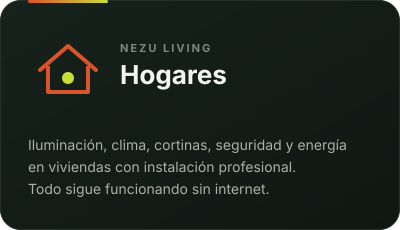
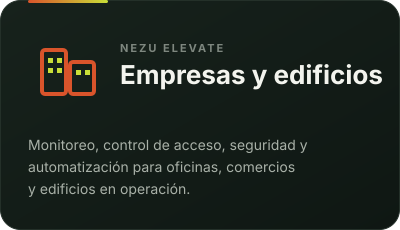
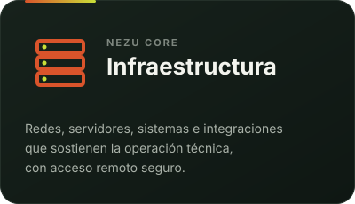
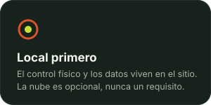
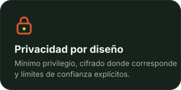
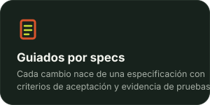
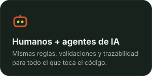

  

&nbsp;
&nbsp;

  

Bienvenido al GitHub de <b>NEZU S.A.S.</b> Aquí construimos el software que hace funcionar los espacios que integramos. Si llegaste buscando un socio técnico, un producto o un equipo con el que colaborar, estás en el lugar correcto.

  

 

## Lo que hacemos

Evaluamos, diseñamos e integramos tecnología para que un espacio funcione mejor, y escribimos el software que lo sostiene. Tres líneas, un mismo criterio: lo que controla el lugar vive en el lugar.

  
  
  

 

## Productos

Software propio, diseñado para funcionar en el sitio del cliente y bajo su control.

  
  

  &nbsp;&nbsp;
  

 

## Cómo construimos

  
  
  
  

 

## Con qué construimos

     
 
     

 

## Código abierto

Lo que podemos compartir, lo compartimos: estas herramientas son gratuitas y las usamos en nuestros propios proyectos. Los productos son otra cosa: Atria se contrata con instalación y soporte, y Arca está en Microsoft Store. ¿Quieres que instalemos o adaptemos una de estas herramientas a tu caso? [Hablemos](https://nezuecuador.com/es/contacto).

| Repositorio | Qué es |
|---|---|
| [nezu-arca-releases](https://github.com/NezuSas/nezu-arca-releases) | Activos públicos firmados que consume NEZU Arca: catálogo de plataformas e iconos con su huella SHA‑256. |
| [nezu-kiosk](https://github.com/NezuSas/nezu-kiosk) | Kiosko empresarial con carrito, códigos QR de pago e impresión térmica. React, Vite y TypeScript. |
| [intentflow-dashboard](https://github.com/NezuSas/intentflow-dashboard) | Panel administrativo del Nezu Intent Manager: estado de intenciones, dispositivos y actividad en tiempo real. Next.js. |
| [adb-bridge](https://github.com/NezuSas/adb-bridge) | Servicio FastAPI en Docker que ejecuta comandos ADB sobre dispositivos Android por IP desde la red local. |
| [nezu-cloudflared-runbook](https://github.com/NezuSas/nezu-cloudflared-runbook) | Runbook ejecutable para montar un túnel de Cloudflare con cloudflared, systemd y QUIC en una MiniPC. |
| [grimbur](https://github.com/NezuSas/grimbur) | Grimbur: Cave of Clues, un roguelite de deducción para teléfonos en React Native y Expo. |

 

 

## ¿Construimos algo juntos?

Integramos espacios, desarrollamos software a medida y abrimos nuestras plataformas a instaladores y socios. 
Cuéntanos qué necesitas y te respondemos con una propuesta concreta.

 

&nbsp;

  

🌐 [nezuecuador.com](https://nezuecuador.com) · ✉️ [nezu.ec@nezuecuador.com](mailto:nezu.ec@nezuecuador.com) · 📍 Cuenca, Ecuador

 

© NEZU S.A.S. · Innovación para vivir mejor.

