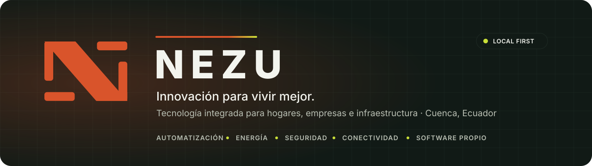

<picture>
  <source media="(prefers-color-scheme: dark)" srcset="assets/banner-dark.svg">
  <source media="(prefers-color-scheme: light)" srcset="assets/banner-light.svg">
  
</picture>

 

**[nezuecuador.com](https://nezuecuador.com)** · **[Servicios](https://nezuecuador.com/es/servicios)** · **[Nosotros](https://nezuecuador.com/es/nosotros)** · **[Contacto](mailto:nezu.ec@nezuecuador.com)**

 

**NEZU S.A.S.** es una empresa ecuatoriana de tecnología. Evaluamos, diseñamos e integramos automatización, energía, seguridad y conectividad para hogares, empresas y edificios, y construimos el software que lo hace funcionar: local primero, con la privacidad como punto de partida y con estándares de ingeniería que se cumplen, no se declaran.

*NEZU is a technology company from Cuenca, Ecuador. We design and integrate automation, energy, security and connectivity for homes, businesses and buildings, and we build the local-first software behind it.*

 

## Qué hacemos

| | Línea | Alcance |
|:-:|---|---|
| 🏠 | **NEZU Living** | Automatización residencial: iluminación, clima, seguridad y energía en viviendas con instalación profesional. |
| 🏢 | **NEZU Elevate** | Monitoreo, acceso, seguridad y control para empresas, edificios y comercios. |
| 🛠️ | **NEZU Core** | Redes, servidores, sistemas e integraciones de infraestructura. |

 

## Productos

<table>
  <tr>
    <td width="50%" valign="top">
      <h3>NEZU Atria</h3>
      
Plataforma de automatización residencial <b>local-first</b>. Corre en un appliance dentro de la casa y mantiene luces, cortinas, clima, cámaras y automatizaciones funcionando aunque no haya internet. Consola web propia para teléfono, tablet y kiosko; asistente por voz en español e inglés con autorización explícita; acceso remoto opcional a través de un túnel seguro.

      
TypeScript · Fastify · React · SQLite · Docker · Home Assistant · ONVIF · Modbus · MQTT

    </td>
    <td width="50%" valign="top">
      <h3>NEZU Arca</h3>
      
Bóveda local cifrada para administrar credenciales y segundos factores en Windows. Cifrado autenticado AES‑256‑GCM con derivación de clave Scrypt; los datos nunca salen del equipo. Disponible en Microsoft Store; sus activos públicos se publican firmados en <a href="https://github.com/NezuSas/nezu-arca-releases">nezu-arca-releases</a>.

      
Python · PyQt5 · AES‑256‑GCM · Scrypt · MSIX

    </td>
  </tr>
</table>

 

## Cómo trabajamos

- **Local primero.** El control físico y los datos sensibles viven en el sitio del cliente. La nube es opcional y nunca un requisito.
- **Privacidad por diseño.** Mínimo privilegio, cifrado donde corresponde y límites de confianza explícitos entre integraciones, red y servicios.
- **Ingeniería guiada por especificaciones.** Cada cambio funcional nace de una spec con criterios de aceptación y evidencia de pruebas, bajo los NEZU Engineering Standards.
- **Humanos y agentes de IA en el mismo flujo.** Las mismas reglas, validaciones y trazabilidad aplican a todo el que toca el código.

 

## Código abierto

| Repositorio | Qué es |
|---|---|
| [nezu-arca-releases](https://github.com/NezuSas/nezu-arca-releases) | Activos públicos firmados que consume NEZU Arca: catálogo de plataformas e iconos con su huella SHA‑256. |
| [nezu-kiosk](https://github.com/NezuSas/nezu-kiosk) | Kiosko empresarial con carrito, códigos QR de pago e impresión térmica. React, Vite y TypeScript. |
| [intentflow-dashboard](https://github.com/NezuSas/intentflow-dashboard) | Panel administrativo del Nezu Intent Manager: estado de intenciones, dispositivos y actividad en tiempo real. Next.js. |
| [adb-bridge](https://github.com/NezuSas/adb-bridge) | Servicio FastAPI en Docker que ejecuta comandos ADB sobre dispositivos Android por IP desde la red local. |
| [nezu-cloudflared-runbook](https://github.com/NezuSas/nezu-cloudflared-runbook) | Runbook ejecutable para montar un túnel de Cloudflare con cloudflared, systemd y QUIC en una MiniPC. |
| [grimbur](https://github.com/NezuSas/grimbur) | Grimbur: Cave of Clues, un roguelite de deducción para teléfonos en React Native y Expo. |

 

## Tecnología

     
 
     

 

## Contacto

| | |
|---|---|
| 🌐 | [nezuecuador.com](https://nezuecuador.com) · español e inglés |
| ✉️ | [nezu.ec@nezuecuador.com](mailto:nezu.ec@nezuecuador.com) |
| 📍 | Cuenca, Ecuador |

Los repositorios de producto son privados. Si trabajas con NEZU y necesitas acceso, escríbenos.

 

© NEZU S.A.S. · Innovación para vivir mejor.

